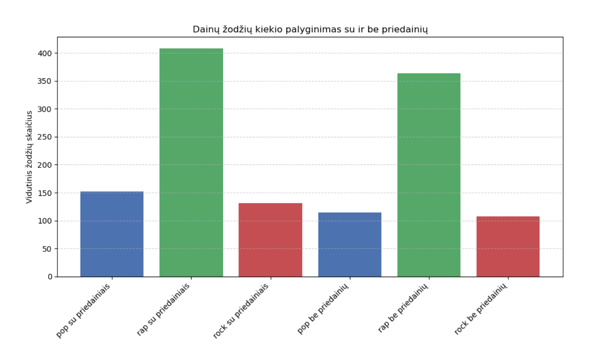

# Song Lyrics Topic Modeling: LSA vs NMF

Dainų tekstų temų nustatymas ir analizė pop, rap ir rock žanruose.

Tikrinama: 
1. Kaip skiriasi temos tarp žanrų;
2. Ar pasikartojančių priedainių šalinimas keičia rezultatus
3. Kuris metodas (LSA ar NMF) pateikia geriau interpretuojamas temas.

VU MIF, Duomenų mokslo studijų programa, projektinis darbas (2025).
Vadovė: prof. dr. Gražina Korvel.

## Duomenys
150 dainų iš Genius API: 3 žanrai, 5 atlikėjai ir kiekvieno atlikėjo 10 dainų.

## Metodika
1. Valymas (regex): skliaustai, intarpai (*oh, yeah*), skaičiai;
2. Lematizacija (spaCy) ir stop žodžių šalinimas (Gensim, 337 žodžiai);
3. TF-IDF kiekvienam žanrui atskirai;
4. LSA (`TruncatedSVD`) ir NMF, po 3 temas žanrui, 10 top žodžių temai;
5. Tas pats su tekstais, kuriuose paliktas tik pirmas priedainis

## Rezultatai

### Vidutinis žodžių skaičius dainoje

Priedainių šalinimas bendrą žodžių skaičių pakeitė minimaliai.
Repo dainose žodžių vidutiniškai daugiau nei dvigubai nei kituose žanruose.

### NMF temos be pasikartojančių priedainių
| Žanras | Tema | Svarbiausi žodžiai | Interpretacija |
|---|---|---|---|
| Pop | 0 | like, know, let, cause, want, think, come, love, time, wake | Meilės troškimas |
| Pop | 1 | breathe, alive, lose, turn, table, soon, great, hurt, today, fight | Tobulėjimas, „žaizdų" gydymas |
| Pop | 2 | mind, hello, feel, wanna, thought, welcome, anymore, year, home, outside | Nostalgija, namų šiluma |
| Rap | 0 | know, like, time, feel, think, need, lie, tell, leave, want | Nepasitikėjimas, apmąstymai |
| Rap | 1 | (necenzūriniai žodžiai), love, know, like, sing, come | Agresija, šiurkšti meilė |
| Rap | 2 | funk, til, humble, let, shop, spot, roof, sit, hypnotize, candy | Naktinis gatvės gyvenimas |
| Rock | 0 | thing, night, know, like, love, mind, baby, way, time, day | Jausmų pokyčiai laikui bėgant |
| Rock | 1 | away, hold, let, soul, want, run, right, control, far, arm | Atsitraukimas, pabėgimas |
| Rock | 2 | close, place, heaven, think, like, bring, let, look, know, cause | Dvasiškumas |

Pilnos LSA ir NMF lentelės (su priedainiais ir be) pateiktos ataskaitoje `report/`.

### Išvados
- Žanrų temos skiriasi: pop – jausmai, nostalgija, savęs pažinimas; rap – asmeniniai išgyvenimai, gatvės kultūra, naktinis gyvenimas; rock – introspektyvios ir egzistencinės temos.
- NMF temos aiškiau interpretuojamos nei LSA (LSA žodžiai abstraktesni).
- Priedainių šalinimas šiek tiek pagerina interpretaciją, bet temų žodžiai keičiasi nedaug.
- Interpretacijos yra subjektyvios, tai autorių nuomonė, nėra faktas.

## Apribojimai
Maža imtis (150 dainų), tik 3 žanrai, fiksuotas temų skaičius, temų kokybė vertinta tik žmogaus akimi.

## Tolesni žingsniai
LDA, PLSA, CTM; Bag of Words vektorizacija; sentimentų analizė; daugiau žanrų ir atlikėjų.

## Autoriai
Justina Seiliūnaitė, Naglis Bražėnas
